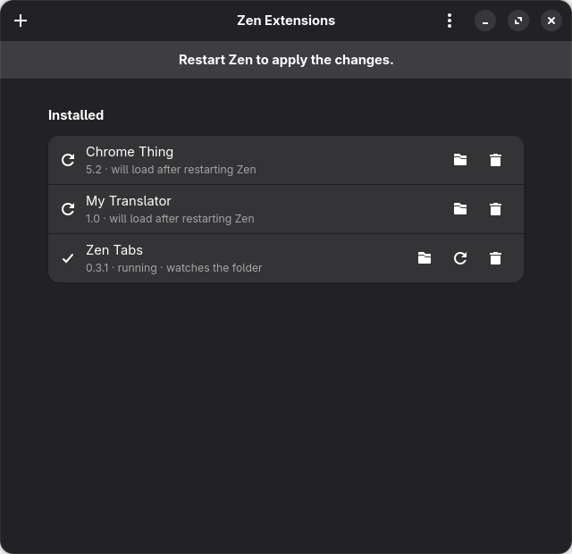

# Zen Extensions

A tool for [Zen Browser](https://zen-browser.app/) that installs **your own and any other extensions** without publishing them on addons.mozilla.org. Add an extension once, and Zen loads it on every start. The tool doesn't need to stay open.

What you can add:

- a folder with `manifest.json`, such as your own project. The folder stays linked to the tool: after you edit it, the extension is rebuilt automatically;
- an `.xpi` or `.zip` file, including a GitHub archive where everything sits in a nested folder;
- a `.crx` from Chrome;
- a link: a direct file link, an addons.mozilla.org page, or a Chrome Web Store page.

The interface is in English and Russian (see "Language").



## Installation

```bash
./install.sh
```

No root access is needed. The installer:

- copies the app to `~/.local/share/zen-ext/app` and creates the `~/.local/bin/zen-ext` command. You can delete the project folder after installing;
- adds "Zen Extensions" to the application menu. You can open `.xpi` and `.crx` files with it by double-clicking;
- enables the `zen-ext-watch` user service, which rebuilds linked folders;
- configures the profile Zen opens by default (see "How it works").

After installing, **restart Zen** once.

To use a different profile: `./install.sh --profile ~/.var/app/app.zen_browser.zen/config/zen/xxxx.Default`. Repeat the option for several profiles.

The window requires PyGObject, GTK 4 and libadwaita. Fedora with GNOME already has them. The commands work without them.

## Usage

**Window.** Drag a file, folder or link into it, or click "+". The buttons in an extension's row open the source folder, rebuild the linked folder, and remove the extension. When Zen needs a restart, a reminder appears at the top.

**Terminal:**

```bash
zen-ext add ~/Projects/zen-tabs              # your own folder, rebuilt automatically
zen-ext add ~/Downloads/something.xpi        # the file is copied, the original can be deleted
zen-ext add https://addons.mozilla.org/en-US/firefox/addon/darkreader/
zen-ext add https://chromewebstore.google.com/detail/<name>/<id>
zen-ext list                                 # what's added and its state in Zen
zen-ext remove zen-tabs                      # by ID or part of the name
zen-ext sync                                 # put everything back into the profile (e.g. after removing it in Zen)
zen-ext profiles                             # Zen profiles
zen-ext language ru                          # interface language: en, ru or auto
```

Extra `add` options:

| Option | What it does |
|---|---|
| `--copy` | take the folder as is, without watching for changes |
| `--id ID` | set your own ID if `manifest.json` has none |
| `--replace` | replace an extension with the same ID installed in Zen from the store |

Changes take effect **after restarting Zen**. That's how Firefox handles extensions installed through the profile folder.

## Language

The interface is in English by default and switches to Russian when the system language is Russian. To pick a language yourself, use the window menu → "Language", or `zen-ext language en|ru`. `zen-ext language auto` goes back to following the system. The choice is saved and applies to both the window and the commands. The `ZEN_EXT_LANG=en|ru` environment variable overrides it for a single run.

## How it works

Like Firefox, Zen scans the profile's `extensions/` folder on every start and loads the `<id>.xpi` files it finds there. Zen is built without mandatory signature checks (`MOZ_REQUIRE_SIGNING` is off), so unsigned extensions can be allowed with a regular pref. The tool adds a block of three prefs to the profile's `user.js` once:

| Pref | Value | Why |
|---|---|---|
| `xpinstall.signatures.required` | `false` | allow unsigned extensions |
| `extensions.autoDisableScopes` | `14` | don't disable extensions placed in the profile folder (normally Firefox disables them and asks the user) |
| `extensions.startupScanScopes` | `1` | scan the profile folder on every start for new, changed and removed files |

The rest of `user.js` stays unchanged. The block is marked with `zen-ext` comments.

When you add an extension, the tool:

1. packs it into an `.xpi` and keeps a copy in `~/.local/share/zen-ext/store/`;
2. adds an ID if `manifest.json` has none: without an ID, Firefox doesn't load an extension from the profile folder. The ID is derived from the name, e.g. `my-ext@zen-ext.local`, and stays the same across updates, so the extension's settings and data are kept;
3. for a Chrome MV3 extension with `background.service_worker`, adds the same file to `background.scripts`, because background service workers are disabled in Zen;
4. puts the `.xpi` into `<profile>/extensions/`.

The tool only touches extensions added through it. If an extension with the same ID is already installed from the store, it stops and asks for `--replace`.

Zen Flatpak updates don't break anything: everything is stored in the profile, not in the app folder.

## States in the list

| State | Meaning |
|---|---|
| running | Zen has loaded the extension |
| will load / will update after restarting Zen | the file is in place, Zen hasn't seen it yet |
| disabled in Zen | disabled in `about:addons`, re-enable it there |
| Zen can't load it | not compatible, see `about:addons` for details |
| removed from the profile | removed in Zen. `zen-ext sync` brings it back, `zen-ext remove` removes it from the list |

## Limitations

- Firefox doesn't automatically grant private window access to extensions added through the profile folder. Enable it in `about:addons` → the extension → "Run in Private Windows".
- Chrome extensions work only if they use APIs that Firefox has. `importScripts()` and other service worker features are unavailable.
- `.git`, `node_modules`, `web-ext-artifacts` and `*.xpi` are not packed from linked folders. If the extension needs files from `node_modules`, build it first and add the build folder.
- Removing an extension also erases its data in Zen.

## Uninstalling

```bash
./uninstall.sh           # the app only; added extensions keep working
./uninstall.sh --purge   # also remove these extensions from Zen and the block from user.js
```

## Development

```bash
python3 -m unittest discover -s tests       # fast tests
python3 tools/e2e.py                        # test against real Zen in a separate .dev/e2e profile
python3 tools/gui_shot.py docs/window.png   # window screenshot with demo data
```

`tools/e2e.py` runs Zen headless with a temporary profile. The test doesn't touch your main profile or an already running Zen. It checks three things:

- unsigned extensions without an ID (a folder and a `.crx` with a service worker) load, and their background code runs;
- after editing a linked folder, the new version is loaded;
- a removed extension disappears.

```
zen_ext/
  core.py    profiles, user.js, packing, installation, state
  cli.py     zen-ext commands
  gui.py     window (GTK 4 + libadwaita)
  watch.py   background rebuild of linked folders
  i18n.py    interface language and the Russian translation
install.sh, uninstall.sh
tests/, tools/
```
